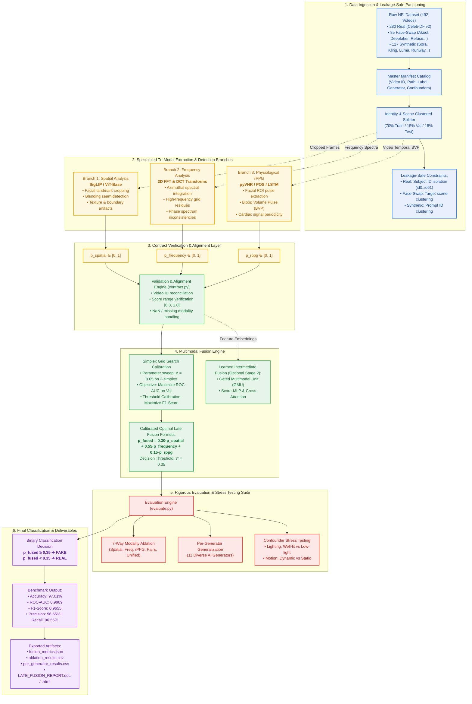
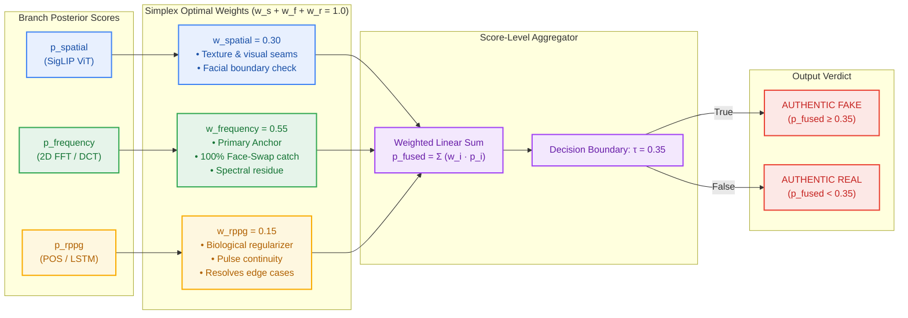
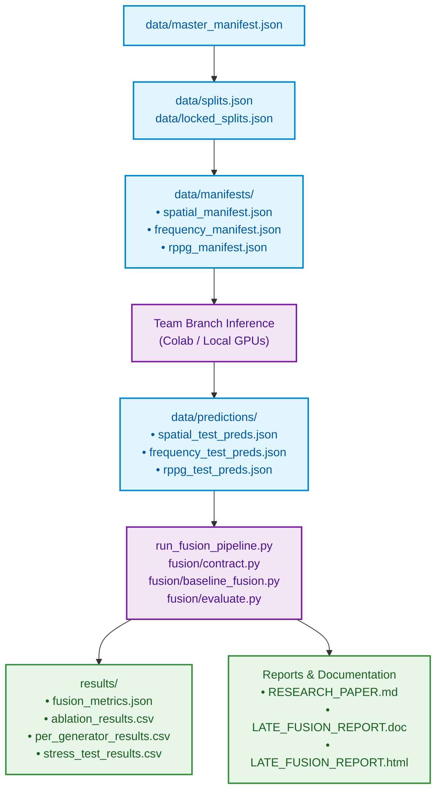

# System Architecture: Unified Multimodal Face Authenticity Detection

This document provides a comprehensive architectural breakdown of the **Unified Face Authenticity Detection Pipeline Against Physical and Digital Attacks**, detailing data ingestion, unimodal branches, alignment contracts, late-fusion optimization, and evaluation suites.

---

## 1. End-to-End System Architecture

---

## 2. Modality Weight Allocation & Interaction Architecture

---

## 3. Data & Artifact Directory Flow

